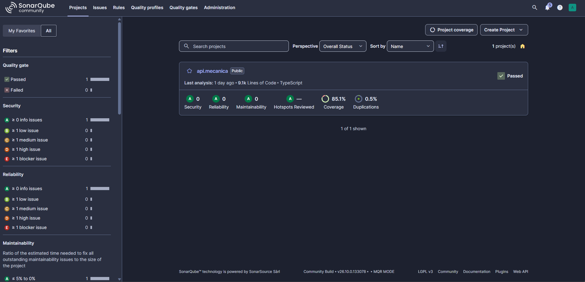

# API Oficina Mecânica

Backend do Tech Challenge — FIAP, Fase 1, voltado à gestão de uma oficina mecânica. O projeto está em TypeScript, utiliza Fastify e organiza o domínio em um monólito modular com conceitos de Domain-Driven Design (DDD).

## Objetivo do projeto

O projeto tem como objetivo disponibilizar uma API para apoiar a gestão de uma oficina mecânica, centralizando o cadastro de clientes e veículos, a abertura e o acompanhamento de ordens de serviço, a elaboração e aprovação de orçamentos, o controle de peças e insumos e a autenticação dos usuários da oficina.

## Descrição resumida da solução

A solução é uma API REST desenvolvida em TypeScript com Fastify e organizada como um monólito modular. Ela separa o domínio em módulos de autenticação, cadastro de clientes e veículos, ordens de serviço, catálogo de serviços, estoque e indicadores de negócio. Cada módulo concentra suas regras de negócio em casos de uso e entidades próprias, enquanto adaptadores HTTP e de persistência integram a aplicação ao PostgreSQL.

O fluxo principal permite cadastrar o cliente e seu veículo, abrir uma ordem de serviço, associar serviços e peças, calcular o orçamento, enviá-lo para aprovação do cliente por e-mail e acompanhar a evolução da ordem até sua conclusão e entrega. A aplicação utiliza JWT para autenticação, controle de permissões por papel, Swagger para documentação da API, Docker para execução da infraestrutura e testes automatizados para validar as regras de negócio e os fluxos HTTP.

## Contexto e objetivo

O sistema modela cinco contextos principais:

- **Registry:** cadastro e consulta de clientes e veículos.
- **Service Order:** ordens de serviço, orçamento, itens e eventos de domínio.
- **Stock:** peças/insumos, entradas, reservas, consumo e baixa de estoque.
- **Auth:** usuários, primeiro acesso, login JWT, papéis e pré-cadastro por gerente.
- **Business Intelligence:** projeções orientadas a eventos para tempo médio de O.S. (lead time total, execução e entrega) e tempo médio de reposição de estoque (ver [`docs/business-intelligence.md`](docs/business-intelligence.md)).

## Estado atual

| Capacidade                                        | Estado                                         | Evidência / observação                                                                                                                                                                                       |
| ------------------------------------------------- | ---------------------------------------------- | ------------------------------------------------------------------------------------------------------------------------------------------------------------------------------------------------------------ |
| Cadastrar cliente                                 | **Implementado e validado via integração E2E** | `src/registry/application/use-cases/register-customer.ts`, `DrizzleCustomerRepository` e rota `POST /customers`                                                                                              |
| Consultar cliente por CPF/CNPJ                    | **Implementado**                               | `find-customer-by-document.ts`, `DrizzleCustomerRepository` e `GET /customers/:cpfCnpj`                                                                                                                      |
| Cadastrar veículo                                 | **Implementado e validado via integração E2E** | `register-vehicle.ts`, `DrizzleVehicleRepository` e `POST /vehicles`                                                                                                                                         |
| Consultar veículo por placa                       | **Implementado**                               | `find-vehicle-by-plate.ts`, `DrizzleVehicleRepository` e `GET /vehicles/:plate`                                                                                                                              |
| Validação de CPF/CNPJ, e-mail, telefone e placa   | **Implementado**                               | Value objects em `src/registry/domain/**/value-objects`                                                                                                                                                      |
| Ordens de serviço no domínio                      | **Implementado e validado via integração E2E** | Repositórios Drizzle, catálogo de serviços, ciclo de execução/entrega e rotas HTTP                                                                                                                           |
| Histórico de fases da OS                          | **Implementado e validado via integração E2E** | Tabela `service_order.order_status_history` (`status`, `value_cents`, `changed_by`, `recorded_at`) e `GET /service-orders/:id/history`                                                                       |
| Consulta do andamento da OS pelo cliente          | **Implementado**                               | `track-service-order.ts` e `POST /service-orders/:id/tracking`, pública, validada pelo CPF/CNPJ do titular do veículo; não expõe quem alterou cada fase                                                      |
| Orçamento e aprovação/rejeição                    | **Implementado e validado via integração E2E** | Persistência atômica orçamento+OS, envio de link único por e-mail (MailHog/SMTP), aprovação, recusa, revogação e expiração                                                                                   |
| Estoque e reservas                                | **Implementado**                               | Agregados, casos de uso, handlers e testes existem; não há endpoints nem repositórios PostgreSQL correspondentes                                                                                             |
| CRUD de clientes e veículos                       | **Implementado**                               | Clientes e veículos possuem cadastro, consulta, atualização e exclusão; as rotas exigem JWT e permissão `CLIENTE_EDITAR`                                                                                     |
| CRUD de serviços (catálogo)                       | **Implementado**                               | Tipos de serviço (`tipo_servico`) e serviços com valor (`servico`) em `/service-types` e `/services`; alteração restrita a `SERVICO_GERENCIAR` (`GERENTE`)                                                   |
| Orçamento automático (serviços + peças)           | **Implementado**                               | Total = soma dos serviços da OS + peças/insumos (quantidade × valor unitário); detalhado no e-mail e em `GET /service-orders/:id/budget`                                                                     |
| CRUD de peças e insumos e controle de estoque     | **Implementado**                               | Cadastro com valor unitário, listagem e consulta com saldo disponível, atualização de descrição/unidade/preço e exclusão lógica (`peca_insumo.ativo`); entradas, reservas e baixas movimentam o saldo        |
| Autenticação JWT e autorização administrativa     | **Implementado**                               | `ActorResolver` + `TokenActorResolver` protegem Registry, Service Order e todas as rotas HTTP de Stock; `ESTOQUE_GERENCIAR`, `USUARIO_PRE_CADASTRAR` e `USUARIO_GERENCIAR` permanecem restritas ao `GERENTE` |
| Dockerfile da aplicação e Docker Compose completo | **Implementado**                               | `Dockerfile` multi-stage e `docker-compose.yml` na raiz (PostgreSQL, MailHog, migrações e API)                                                                                                               |

## Arquitetura e DDD

A solução é um monólito modular organizado em camadas:

- `domain/`: entidades/agregados, objetos de valor, eventos e contratos de repositório.
- `application/use-cases/`: orquestração dos casos de uso.
- `application/handlers/`: consumidores e políticas acionadas por eventos.
- `infra/`: adaptadores HTTP, envio de e-mail SMTP e persistência.
- `shared/`: abstrações compartilhadas, exceções, IDs, eventos e Event Bus.

Os agregados e conceitos identificados incluem `Customer`, `Vehicle`, `ServiceOrder`, `Budget`, `ApprovalRequest`, `PartSupply`, `SupplyReservation` e `User`. Entre os objetos de valor estão `CpfCnpj`, `Email`, `Telephone`, `Plate`, `Quantity`, `UnitOfMeasure`, `PartCode`, `Role` e objetos de status.

Os módulos se comunicam por um `InMemoryEventBus`, implementado em `src/shared/application/in-memory-event-bus.ts`. A decisão está registrada em [`docs/adr/event-bus.md`](docs/adr/event-bus.md). O desenho atual assume consistência eventual entre contextos, com handlers para notificação de orçamento/retirada e para reservar, liberar, consumir e baixar insumos.

### Status de ordem de serviço

O domínio usa os valores em inglês `PENDING`, `AWAITING_APPROVAL`, `REJECTED`, `APPROVED`, `IN_PROGRESS`, `PAUSED`, `COMPLETED`, `DELIVERED` e `CANCELLED`, com transições definidas em `src/service-order/domain/service-order/value-objects/service-order-status.ts`:

```text
PENDING            -> AWAITING_APPROVAL | APPROVED | CANCELLED
AWAITING_APPROVAL  -> APPROVED | REJECTED | CANCELLED
REJECTED           -> (final)
APPROVED           -> IN_PROGRESS | CANCELLED
IN_PROGRESS        -> PAUSED | COMPLETED | CANCELLED
PAUSED             -> IN_PROGRESS | CANCELLED
COMPLETED          -> DELIVERED
DELIVERED          -> (final)
CANCELLED          -> (final)
```

Estados encerrados ou terminais (`COMPLETED`, `DELIVERED`, `REJECTED` e `CANCELLED`, identificados por `ServiceOrderStatus.isClosed()`) bloqueiam a inclusão de novos insumos (`addSupply`).

### Histórico de fases da OS e isolamento com o módulo de Auth

Cada transição de fase da OS é registrada cronologicamente em `service_order.order_status_history` (migração `infra/postgres/init/05-order-status-history.sql`) com:

- `status`: fase da OS (`PENDING`, `AWAITING_APPROVAL`, `APPROVED`, `REJECTED`, `IN_PROGRESS`, `PAUSED`, `COMPLETED`, `DELIVERED`, `CANCELLED`).
- `value_cents` (`valueCents`): valor orçado em centavos quando a vistoria/orçamento já foi realizada (`NULL` na abertura em `PENDING`, gravado diretamente a partir do `Budget` persistido na mesma transação em `AWAITING_APPROVAL` e preservado nas fases subsequentes).
- `changed_by` (`changedBy`): identificador do usuário autenticado que efetuou a mudança ou `NULL` em transições públicas/automáticas (aprovação/recusa pelo cliente via link de e-mail ou expiração de token).
- `recorded_at` (`recordedAt`): data/hora da mudança de fase.

Para identificar o usuário sem quebrar o isolamento entre os módulos `service-order` e `auth` (que utiliza JWT com `jose`):

1. **Porta no módulo `service-order` (`src/service-order/application/ports/actor-resolver.ts`):** define o contrato `ActorResolver` (`resolve(authorizationHeader?: string): Promise<string | null>`) e o contexto assíncrono `actorContext` (`AsyncLocalStorage<string | null>`). O módulo `service-order` não importa nada de `src/auth/` nem conhece JWT ou `jose`.
2. **Adaptador por tipagem estrutural em `src/infra/token-actor-resolver.ts`:** `TokenActorResolver` extrai o token `Bearer <jwt>` do header `Authorization` e aceita, por _structural typing_ (`TokenVerifier`), tanto `JoseTokenService` (`{ verify(token): Promise<string | null> }`) quanto `ResolveAuthenticatedUser` (`{ execute(token): Promise<{ id: { value: string } }> }`) do módulo `auth`. Para conectá-lo no bootstrap (`src/index.ts`), basta injetar `actorResolver: new TokenActorResolver(tokenService)` no `serviceOrderCompositionRoot`.
3. **Propagação via `AsyncLocalStorage` (`src/service-order/infra/http/service-order-routes.ts`):** um hook `preHandler` do Fastify resolve o ator no início da requisição e executa o handler dentro de `actorContext.run(actorId, done)`. Assim, `DrizzleServiceOrderRepository` e `DrizzleApprovalRequestRepository` gravam `changed_by` automaticamente sem acoplar entidades de domínio ou casos de uso a headers HTTP.
4. **Desacoplamento no banco:** a coluna `changed_by VARCHAR(320)` em `service_order.order_status_history` não possui _foreign key_ cruzada para `public.auth_users`, preservando a autonomia de schema de cada contexto delimitado e aceitando tanto UUID quanto `sub`/e-mail do JWT.

### Documentação DDD

- [Quadro de documentação DDD no Miro](https://miro.com/app/board/uXjVHn__d18=/)
- ADR do monólito modular com DDD e Clean Architecture: [`docs/adr/modular-monolith.md`](docs/adr/modular-monolith.md)
- ADR do Event Bus: [`docs/adr/event-bus.md`](docs/adr/event-bus.md)
- ADR das projeções de Business Intelligence: [`docs/adr/business-intelligence-projections.md`](docs/adr/business-intelligence-projections.md)
- ADR do PostgreSQL: [`docs/adr/postgresql-database.md`](docs/adr/postgresql-database.md)
- ADR de autenticação e autorização: [`docs/adr/authentication-authorization.md`](docs/adr/authentication-authorization.md)
- ADR do MailHog no MVP: [`docs/adr/mailhog-mvp-email.md`](docs/adr/mailhog-mvp-email.md)
- Fluxos Auth: [`docs/plantuml/flows/auth-service.puml`](docs/plantuml/flows/auth-service.puml)
- Event Storming: [`docs/ddd/event-storming-os.pdf`](docs/ddd/event-storming-os.pdf)

- Diagrama de domínio / linguagem ubíqua / glossário:[`docs/ddd/linguagem-ubiqua.pdf`](docs/ddd/linguagem-ubiqua.pdf)

## Tecnologias

- Node.js e TypeScript ESM (`module: nodenext`), modo estrito.
- Fastify 5, Zod e `fastify-type-provider-zod`.
- Drizzle ORM, `drizzle-kit` e `pg`.
- Nodemailer e MailHog para envio e teste de e-mails transacionais.
- PostgreSQL 17 no ambiente Docker do banco.
- Argon2id para senhas, `jose` para JWT e `@fastify/rate-limit` para limitar tentativas de autenticação.
- Vitest 5 para testes.
- ESLint, Prettier e configuração opcional de SonarQube.

## Pré-requisitos

- Node.js e npm em versões recentes, compatíveis com as dependências declaradas no `package.json`.
- Docker com Docker Compose, preferencialmente uma versão recente com suporte ao recurso `include` utilizado pelo Compose completo da raiz.
- Git, para clonar o repositório.

Não é necessário utilizar uma versão exata de Node.js, npm ou Docker. O projeto não fixa essas versões por `.nvmrc` ou pelo campo `engines`; basta utilizar versões recentes compatíveis com as ferramentas e dependências do projeto.

## Configuração do ambiente

Instale as dependências:

```bash
npm install
```

O banco lê `infra/postgres/.env`. Crie esse arquivo a partir do exemplo, sem versionar credenciais:

```bash
cp infra/postgres/.env.example infra/postgres/.env
```

Variáveis reconhecidas:

```text
POSTGRES_USER=<usuário do PostgreSQL>
POSTGRES_PASSWORD=<senha do PostgreSQL>
POSTGRES_DB=<nome do banco>
POSTGRES_HOST=<opcional; host do PostgreSQL, padrão localhost>
POSTGRES_PORT=<porta local, normalmente 5432>
SMTP_HOST=<host SMTP, ex.: localhost>
SMTP_PORT=<porta SMTP, ex.: 1025>
SMTP_FROM=<remetente, ex.: oficina@localhost>
FRONTEND_URL=<URL base para links de aprovação, ex.: http://localhost:3000>
APPROVAL_TOKEN_TTL_MINUTES=<validade do link de aprovação em minutos>
DATABASE_URL=<opcional; tem prioridade sobre as variáveis individuais>
INITIAL_MANAGER_PASSWORD=<senha temporária do gerente inicial; obrigatória>
JWT_SECRET=<chave de assinatura JWT; obrigatória, com pelo menos 32 bytes>
BI_REORDER_POINT=<opcional; ponto de reposição usado pelo módulo de BI, padrão 0>
```

`INITIAL_MANAGER_PASSWORD` e `JWT_SECRET` são obrigatórias para iniciar a aplicação. `BI_REORDER_POINT` é opcional e tem padrão `0`. `src/infra/database/connection.ts` também carrega `infra/postgres/.env` no desenvolvimento. O arquivo `.env` real não deve ser publicado; substitua todos os valores de exemplo, principalmente as senhas e a chave JWT.

## Banco de dados

O banco de dados escolhido é o **PostgreSQL**. A decisão foi tomada porque o domínio da oficina é fortemente relacional e exige integridade entre clientes, veículos, ordens de serviço, orçamentos e estoque. O PostgreSQL oferece chaves estrangeiras, constraints, índices únicos parciais e transações ACID, permitindo garantir regras importantes e operações atômicas mesmo em cenários concorrentes.

Além disso, a tecnologia possui ampla documentação, suporte maduro no ecossistema Node.js, integração com `pg` e Drizzle ORM, ausência de custo de licença e uma imagem oficial para execução com Docker Compose. Essas características tornam o ambiente local e de testes mais simples, reprodutível e adequado ao MVP.

A escolha e suas consequências estão detalhadas no [ADR do PostgreSQL](docs/adr/postgresql-database.md). No código, ela está refletida em `pg`, `drizzle-orm/node-postgres`, `drizzle.config.ts`, `infra/postgres/docker-compose.yml` e nos scripts SQL iniciais.

Há duas representações no banco:

- `src/infra/database/schema.ts` contém tabelas Drizzle para cliente, veículo, serviço e estoque. O histórico de movimentações (`movimento_estoque`) registra cada entrada e saída de insumos, incluindo a quantidade movimentada, data, tipo e observação com motivo e saldo anterior/atual. O catálogo de serviços fica em `tipo_servico` (`id`, `nome`) e `servico` (`id`, `nome`, `descricao`, `valor` em centavos, `tipo_servico_id`). Também contém o schema `service_order` para OS (`orders`), peças/insumos da OS (`supply_items`), serviços da OS (`order_services`), orçamentos (`budgets`), solicitações de aprovação (`approval_requests`) e histórico de fases da OS (`order_status_history`).
- `infra/postgres/init/01-schema.sql` contém o modelo legado em `public` (incluindo `peca_insumo`, cujo `valor` guarda o preço unitário em centavos, e `os_status_historico`).

Os scripts SQL em `infra/postgres/init/` (`01-schema.sql` a `06-business-intelligence.sql`) são executados automaticamente quando o volume do PostgreSQL é criado pela primeira vez. As migrações do Drizzle em `drizzle/` são separadas e criam/atualizam as tabelas de autenticação, estoque (incluindo o histórico de movimentações) e, em `0004_service_catalog.sql`, o catálogo de serviços, os serviços e preços da OS e a remoção de `orders.value_cents`. Elas dependem das tabelas criadas pelos scripts de init, por isso rode `npm run db:migrate` depois de subir o banco.

Os comandos disponíveis para o banco são:

```bash
npm run db:generate
npm run db:migrate
npm run db:push
npm run db:studio
npm run db:test
```

Os repositórios Drizzle de OS, orçamento, catálogo de serviços e aprovação implementam os contratos com transações e controle otimista/pessimista de versão. Para um volume existente, aplique os scripts incrementais conforme o [README do PostgreSQL](infra/postgres/README.md).

## Execução local

Após instalar as dependências, configure o ambiente e inicie o banco e o MailHog:

```bash
cp infra/postgres/.env.example infra/postgres/.env
# edite infra/postgres/.env e troque os valores de exemplo
npm install
cd infra/postgres
docker compose up -d
cd ../..
npm run db:migrate
```

O `docker compose up -d` executa os scripts de `infra/postgres/init/` somente
quando o volume `postgres_data` é criado. O `npm run db:migrate` é necessário
para aplicar as migrações versionadas do Drizzle, inclusive a tabela
`auth_users`. Em um volume já existente, não conte com os scripts de init para
aplicar alterações; use as instruções incrementais de
[`infra/postgres/README.md`](infra/postgres/README.md).

Depois, os scripts do projeto são:

```bash
npm run dev          # desenvolvimento; executa src/index.ts em watch
npm run build        # compila para dist/
npm start             # executa dist/index.js; rode npm run build antes
```

Com a API em execução, verifique `http://localhost:3000/health`. A interface
web do MailHog fica em `http://localhost:8025`.

O bootstrap HTTP existente é `src/index.ts`. A aplicação usa `HOST=0.0.0.0` e `PORT=3000` por padrão, podendo receber essas variáveis pelo ambiente, além de executar periodicamente `expirePending` para expirar solicitações de aprovação vencidas. A inicialização depende de uma conexão PostgreSQL válida, de `INITIAL_MANAGER_PASSWORD` não vazia e de `JWT_SECRET` com pelo menos 32 bytes; sem essas variáveis, ela falha antes de abrir a porta.

### Fluxo de autenticação

Para instruções de uso e permissões por papel, consulte o [guia de autenticação e autorização](docs/authorization.md).

Na primeira execução com `auth_users` vazia, o bootstrap cria `admin@admin.com` como `GERENTE` em estado `PENDING_FIRST_ACCESS`, com a senha temporária definida em `INITIAL_MANAGER_PASSWORD` armazenada como hash Argon2id. O seed não redefine a senha em reinicializações nem cria outro gerente caso já existam usuários.

1. Envie `POST /auth/first-access` com `{"email":"admin@admin.com","temporaryPassword":"<senha temporária>","newPassword":"<nova senha>"}`. A nova senha deve ser diferente, ter pelo menos 8 caracteres e conter somente letras e números. Sucesso: `204`.
2. Envie `POST /auth/login` com `{"email":"admin@admin.com","password":"<nova senha>"}`. Um usuário `ACTIVE` recebe `{"token":"<jwt>"}`; o token HS256 expira em 4 horas. Usuários pendentes devem concluir o primeiro acesso antes de fazer login.
3. Com o token do gerente, envie `POST /users` com `Authorization: Bearer <jwt>` e `{"email":"pessoa@example.com","role":"ATENDENTE"}`. Sucesso: `201` com `{"temporaryPassword":"<senha gerada>"}`. Entregue essa senha ao usuário por canal seguro: ela é retornada em claro nessa única resposta e o novo usuário também deverá fazer primeiro acesso.

Papéis aceitos: `ATENDENTE`, `MECANICO`, `ESTOQUISTA` e `GERENTE`. Apenas o gerente ativo tem permissão para pré-cadastrar usuários. O controller consulta o usuário no banco a cada requisição autenticada, para que desativação ou mudança de papel não espere o JWT expirar. Login e primeiro acesso têm limite de **5 requisições por minuto por IP e por rota** (`429` ao exceder), armazenado na memória do processo; múltiplas instâncias exigiriam um armazenamento compartilhado. Use HTTPS ao expor senhas e tokens.

## Docker

O Compose disponível em [`infra/postgres/docker-compose.yml`](infra/postgres/docker-compose.yml) provisiona os serviços `postgres` e `mailhog` (SMTP na porta 1025 e interface web na porta 8025).

```bash
cd infra/postgres
docker compose up -d
docker compose ps
docker compose logs -f postgres
docker compose down
```

### Aplicação completa em containers

O [`Dockerfile`](Dockerfile) gera uma imagem multi-stage (Node 24, Debian slim) com o código compilado, somente as dependências de produção, as migrações de `drizzle/` e a página `public/orcamento.html`. A imagem roda como usuário `node`, expõe a porta 3000 e tem `HEALTHCHECK` em `/health`.

O [`docker-compose.yml`](docker-compose.yml) da raiz inclui o Compose de `infra/postgres` e acrescenta:

- `migrate`: executa uma vez `node dist/infra/database/migrate.js` (migrador do `drizzle-orm`, sem `drizzle-kit`) depois que o PostgreSQL fica saudável;
- `api`: sobe somente após as migrações terminarem com sucesso, apontando para `postgres` e `mailhog` na rede do Compose.

Ambos leem `infra/postgres/.env` (inclusive `INITIAL_MANAGER_PASSWORD` e `JWT_SECRET`). A partir da raiz:

```bash
cp infra/postgres/.env.example infra/postgres/.env
# edite infra/postgres/.env e troque os valores de exemplo
docker compose up -d --build
docker compose logs migrate
docker compose ps
```

A API fica em `http://localhost:3000` (Swagger em `/docs`; a porta pode ser trocada com `API_PORT`) e o MailHog em `http://localhost:8025`. Use este Compose **ou** o de `infra/postgres`, não os dois ao mesmo tempo: os dois usam o container `oficina-postgres` e as mesmas portas, e cada um tem o próprio volume de dados. Para reaplicar as migrações sem Docker, após `npm run build`, use `npm run db:migrate:deploy`.

O Compose de SonarQube está em [`infra/sonarqube/docker-compose.yml`](infra/sonarqube/docker-compose.yml).

## API HTTP

O Fastify registra Swagger e Swagger UI em `/docs`. A especificação OpenAPI é gerada a partir das rotas registradas.

| Método               | Rota                                                                                                     | Finalidade                                                                                                                                                                            | Autenticação / Permissão                                              |
| -------------------- | -------------------------------------------------------------------------------------------------------- | ------------------------------------------------------------------------------------------------------------------------------------------------------------------------------------- | --------------------------------------------------------------------- |
| `GET`                | `/health`                                                                                                | Verifica a aplicação e executa `SELECT 1` no banco                                                                                                                                    | Não                                                                   |
| `POST`               | `/auth/first-access`                                                                                     | Troca a senha temporária no primeiro acesso                                                                                                                                           | Não (rate-limit: 5/min por IP)                                        |
| `POST`               | `/auth/login`                                                                                            | Autentica usuário ativo e emite JWT HS256 (4h)                                                                                                                                        | Não (rate-limit: 5/min por IP)                                        |
| `POST`               | `/users`                                                                                                 | Pré-cadastra usuário com senha temporária                                                                                                                                             | Bearer JWT (`USUARIO_PRE_CADASTRAR` — `GERENTE`)                      |
| `POST`               | `/customers`                                                                                             | Cadastra cliente                                                                                                                                                                      | Bearer JWT (`CLIENTE_EDITAR` — `ATENDENTE` ou `GERENTE`)              |
| `GET`                | `/customers/:cpfCnpj`                                                                                    | Consulta cliente por CPF/CNPJ                                                                                                                                                         | Bearer JWT (`CLIENTE_EDITAR` — `ATENDENTE` ou `GERENTE`)              |
| `PATCH`              | `/customers/:cpfCnpj`                                                                                    | Atualiza somente e-mail e telefone; nome e CPF/CNPJ são imutáveis após o cadastro                                                                                                     | Bearer JWT (`CLIENTE_EDITAR`)                                         |
| `DELETE`             | `/customers/:cpfCnpj`                                                                                    | Exclui cliente sem veículos vinculados                                                                                                                                                | Bearer JWT (`CLIENTE_EDITAR` — `ATENDENTE` ou `GERENTE`)              |
| `POST`               | `/vehicles`                                                                                              | Cadastra veículo vinculado a cliente                                                                                                                                                  | Bearer JWT (`CLIENTE_EDITAR` — `ATENDENTE` ou `GERENTE`)              |
| `GET`                | `/vehicles/:plate`                                                                                       | Consulta veículo por placa                                                                                                                                                            | Bearer JWT (`CLIENTE_EDITAR` — `ATENDENTE` ou `GERENTE`)              |
| `PATCH`              | `/vehicles/:id`                                                                                          | Atualiza somente a cor; demais dados do veículo são imutáveis após o cadastro                                                                                                         | Bearer JWT (`CLIENTE_EDITAR` — `ATENDENTE` ou `GERENTE`)              |
| `DELETE`             | `/vehicles/:id`                                                                                          | Exclui veículo                                                                                                                                                                        | Bearer JWT (`CLIENTE_EDITAR` — `ATENDENTE` ou `GERENTE`)              |
| `POST`/`GET`         | `/service-types`                                                                                         | Cadastra / lista tipos de serviço (`name`)                                                                                                                                            | Bearer JWT (`POST`: `SERVICO_GERENCIAR`; `GET`: qualquer papel ativo) |
| `GET`/`PUT`/`DELETE` | `/service-types/:id`                                                                                     | Consulta, renomeia ou exclui tipo de serviço (409 se houver serviços vinculados)                                                                                                      | Bearer JWT (`GET`: qualquer papel ativo; demais: `SERVICO_GERENCIAR`) |
| `POST`/`GET`         | `/services`                                                                                              | Cadastra / lista serviços (`name`, `description`, `priceCents`, `serviceTypeId`; filtro `?serviceTypeId=`)                                                                            | Bearer JWT (`POST`: `SERVICO_GERENCIAR`; `GET`: qualquer papel ativo) |
| `GET`/`PUT`/`DELETE` | `/services/:id`                                                                                          | Consulta, atualiza ou exclui serviço do catálogo                                                                                                                                      | Bearer JWT (`GET`: qualquer papel ativo; demais: `SERVICO_GERENCIAR`) |
| `POST`               | `/service-orders`                                                                                        | Cadastra OS (`description`, `vehicleId`, `serviceIds` opcional)                                                                                                                       | Bearer JWT (`OS_CRIAR`)                                               |
| `GET`                | `/service-orders`                                                                                        | Lista OS (mais recentes primeiro) com `totalCents` e `openedAt`; filtros `status` (separados por vírgula), `vehicleId`, `limit` (1–100, padrão 20) e `offset`                         | Bearer JWT (qualquer papel ativo)                                     |
| `GET`                | `/service-orders/:serviceOrderId`                                                                        | Consulta OS (`services`, `supplies` com valor unitário e `totalCents`)                                                                                                                | Bearer JWT (qualquer papel ativo)                                     |
| `POST`               | `/service-orders/:serviceOrderId/services`                                                               | Inclui serviço do catálogo na OS em `PENDING` (copia nome e valor)                                                                                                                    | Bearer JWT (`OS_CONCLUIR`)                                            |
| `DELETE`             | `/service-orders/:serviceOrderId/services/:serviceId`                                                    | Remove serviço da OS em `PENDING`                                                                                                                                                     | Bearer JWT (`OS_CONCLUIR`)                                            |
| `GET`                | `/service-orders/:serviceOrderId/budget`                                                                 | Detalha o orçamento: status, serviços, peças, subtotais, `totalCents` (orçado) e `currentTotalCents` (atual)                                                                          | Bearer JWT (qualquer papel ativo)                                     |
| `GET`                | `/service-orders/:serviceOrderId/history`                                                                | Consulta histórico de fases da OS (`status`, `valueCents`, `changedBy` e `recordedAt`)                                                                                                | Bearer JWT (qualquer papel ativo)                                     |
| `POST`               | `/service-orders/:serviceOrderId/tracking`                                                               | Cliente consulta status atual, valor e histórico de fases (`status`, `recordedAt`) informando `document` (CPF/CNPJ do titular do veículo) no corpo; documento divergente responde 404 | Pública (rate-limit: 10/min por IP)                                   |
| `POST`               | `/service-orders/:serviceOrderId/supplies`                                                               | Inclui insumo (`partCode`, `quantity`)                                                                                                                                                | Bearer JWT (`ESTOQUE_BAIXAR`)                                         |
| `POST`               | `/service-orders/:serviceOrderId/supplies/:partCode/usage`                                               | Registra uso do insumo                                                                                                                                                                | Bearer JWT (`ESTOQUE_BAIXAR`)                                         |
| `PATCH`              | `/service-orders/:serviceOrderId/description`                                                            | Atualiza a descrição durante a avaliação da OS em `PENDING`                                                                                                                           | Bearer JWT (`OS_CONCLUIR`)                                            |
| `POST`               | `/service-orders/:serviceOrderId/awaiting-approval`                                                      | Gera o orçamento (serviços + peças), atualiza `description` (opcional) e envia o link de aprovação com o detalhamento                                                                 | Bearer JWT (`OS_CONCLUIR`)                                            |
| `POST`               | `/service-orders/:serviceOrderId/start`                                                                  | Inicia execução da OS (`IN_PROGRESS`)                                                                                                                                                 | Bearer JWT (`OS_CONCLUIR`)                                            |
| `POST`               | `/service-orders/:serviceOrderId/finish`                                                                 | Finaliza execução da OS (`COMPLETED`) e notifica cliente                                                                                                                              | Bearer JWT (`OS_CONCLUIR`)                                            |
| `POST`               | `/service-orders/:serviceOrderId/deliver`                                                                | Registra entrega do veículo (`DELIVERED`)                                                                                                                                             | Bearer JWT (`OS_CRIAR`)                                               |
| `POST`               | `/service-orders/:serviceOrderId/cancel`                                                                 | Cancela OS                                                                                                                                                                            | Bearer JWT (`OS_CRIAR`)                                               |
| `POST`               | `/budget-approvals/decide`                                                                               | Confirma aprovação ou recusa do orçamento por token                                                                                                                                   | Pública (link de uso único enviado por e-mail)                        |
| `GET`                | `/orcamento/:token` e `/orcamento`                                                                       | Página web de aprovação/recusa do orçamento                                                                                                                                           | Pública                                                               |
| `GET`                | `/bi/service-orders/lead-time`                                                                           | Consulta tempo médio de OS (total, execução e entrega)                                                                                                                                | Bearer JWT (`BI_VISUALIZAR` — `GERENTE`)                              |
| `GET`                | `/bi/stock/restock-lead-time`                                                                            | Consulta tempo médio de reposição de estoque (geral e por peça)                                                                                                                       | Bearer JWT (`BI_VISUALIZAR` — `GERENTE`)                              |
| `POST`               | `/stock/parts`                                                                                           | Cadastra peça/insumo (`description`, `partCode`, `quantity` inicial, `unitOfMeasure`, `unitPriceCents`); código duplicado retorna 409                                                 | Bearer JWT (`ESTOQUE_GERENCIAR` — `GERENTE`)                          |
| `GET`                | `/stock/parts`                                                                                           | Lista peças ativas com saldo disponível (`quantity`), unidade e preço                                                                                                                 | Bearer JWT (qualquer papel ativo)                                     |
| `GET`                | `/stock/parts/:partCode`                                                                                 | Consulta peça ativa com saldo disponível                                                                                                                                              | Bearer JWT (qualquer papel ativo)                                     |
| `PUT`                | `/stock/parts/:partCode`                                                                                 | Atualiza descrição, unidade e preço; código e saldo não mudam por aqui                                                                                                                | Bearer JWT (`ESTOQUE_GERENCIAR` — `GERENTE`)                          |
| `DELETE`             | `/stock/parts/:partCode`                                                                                 | Exclusão lógica: mantém o histórico, sai do catálogo e não pode mais entrar em OS; 409 com reserva em aberto                                                                          | Bearer JWT (`ESTOQUE_GERENCIAR` — `GERENTE`)                          |
| `POST`               | `/stock/entries`                                                                                         | Registra entrada de estoque (`partCode`, `quantity`)                                                                                                                                  | Bearer JWT (`ESTOQUE_GERENCIAR` — `GERENTE`)                          |
| `POST`               | `/stock/reservations`, `/stock/reservations/:serviceOrderId/cancel`, `/stock/write-offs/:serviceOrderId` | Reserva, cancela reservas e baixa insumos de uma OS                                                                                                                                   | Bearer JWT (`ESTOQUE_GERENCIAR` — `GERENTE`)                          |
| `GET`                | `/docs`                                                                                                  | Interface Swagger UI                                                                                                                                                                  | Não                                                                   |

A validação de payload usa Zod; erros de validação retornam HTTP 400 e exceções de aplicação/domínio são convertidas pelo error handler central em `src/app.ts`.

Durante a avaliação (`PENDING`), mecânico e gerente podem salvar ou revisar a descrição com `PATCH /service-orders/:serviceOrderId/description`, enviando `{ "description": "Pastilhas desgastadas; substituir o par dianteiro." }`. O texto substitui o campo `description` da OS, deve conter conteúdo e tem os espaços das extremidades removidos. Também pode ser informado no envio para aprovação; quando omitido, a descrição anterior é preservada. O texto salvo aparece na consulta da OS e no e-mail do orçamento. A edição fica bloqueada após o envio para aprovação.

No Registry, a atualização de cliente aceita somente `email` e `tel`. O nome e o CPF/CNPJ não podem ser alterados após o cadastro. A atualização de veículo aceita somente `color`; modelo, ano, marca, placa, cliente vinculado e ID são imutáveis. A exclusão de um cliente com veículos vinculados retorna HTTP 409.

Os controllers de OS usam `DrizzleServiceOrderRepository`, `DrizzleBudgetRepository`, `DrizzleApprovalRequestRepository` e a mesma instância de `InMemoryEventBus` usada no cadastro. A OS guarda `vehicleId`, os serviços do catálogo incluídos (`service_order.order_services`, com nome e valor copiados no momento da inclusão) e as peças/insumos (`service_order.supply_items`, com descrição e valor unitário copiados do estoque por `StockPartCatalog`); `RegistryVehicleContactLookup` valida a existência do veículo e consulta o contato do cliente. Ao acionar `POST /service-orders/:serviceOrderId/awaiting-approval`, o orçamento é gerado somando os serviços e as peças (quantidade × valor unitário) e persistido (`PENDING`) **atomicamente na mesma transação** que a transição da OS para `AWAITING_APPROVAL`; em seguida, o evento `service-order.awaiting-approval` envia por e-mail o orçamento detalhado (serviços, peças, subtotais e total) com um token de uso único (persistindo apenas o hash SHA-256 em `service_order.approval_requests`). A decisão é confirmada via `POST /budget-approvals/decide` (`approved` ou `rejected`), atualizando orçamento e OS. Cancelar uma OS (`POST /service-orders/:serviceOrderId/cancel`) revoga na mesma transação quaisquer solicitações de aprovação pendentes, e a rotina periódica `expirePending` filtra ordens em `AWAITING_APPROVAL` antes do limite de lote (`LIMIT 100`). Ao finalizar a OS (`POST /service-orders/:serviceOrderId/finish`), o evento `service-order.finished` envia o e-mail informando que o veículo está pronto para retirada. Todas as mudanças de fase são gravadas em `service_order.order_status_history` com data (`recordedAt`), valor (`valueCents`) e autor da transição (`changedBy`, resolvido via `ActorResolver` / `TokenActorResolver` a partir do header `Authorization: Bearer <jwt>`). Conflitos de versão retornam HTTP 409.

Exemplo de cadastro de OS:

```bash
curl -X POST http://localhost:3000/service-orders \
  -H 'Authorization: Bearer <jwt>' \
  -H 'Content-Type: application/json' \
  -d '{"description":"Barulho ao frear","vehicleId":"ID_DO_VEICULO","serviceIds":["ID_DO_SERVICO"]}'
```

A autenticação (`401 Unauthorized` para token ausente, inválido ou usuário inativo) e a verificação de permissões por papel (`403 Forbidden`) nas rotas de OS são realizadas de forma desacoplada por `ActorResolver` (`src/service-order/application/ports/actor-resolver.ts`) e `TokenActorResolver` (`src/infra/token-actor-resolver.ts`), sem acoplamento direto entre `src/service-order/` e `src/auth/`.

## Testes e qualidade

Comandos disponíveis:

```bash
npm test
npm run test:coverage
npm run typecheck
npm run lint
npm run format:check
npm run build
```

Na análise desta versão:

- **61 arquivos de teste** (60 suítes unitárias/HTTP + 1 suíte de integração E2E com PostgreSQL e MailHog reais).
- **477 testes** (476 testes unitários/HTTP + 1 fluxo E2E completo).
- `typecheck`, `lint` e `build` concluíram sem erros.

Os testes incluem testes unitários de domínio/aplicação, testes de repositórios Drizzle, testes de rotas HTTP via `app.inject` (incluindo primeiro acesso, login e pré-cadastro em `src/app.spec.ts`) e o teste de integração ponta a ponta (`src/service-order/infra/http/service-order-real.integration.spec.ts`) validado contra PostgreSQL e MailHog reais.

### Análise SonarQube

O projeto `api.mecanica` foi analisado no SonarQube (Community Build) e **passou no Quality Gate**: nota **A** em Security, Reliability, Maintainability e Hotspots Reviewed, sem issues abertas, com **85,1% de cobertura** e **0,5% de duplicação** em ~9,1k linhas de TypeScript.



## Estrutura relevante

```text
src/
├── app.ts                         # Fastify, Swagger, health check e erros
├── index.ts                       # bootstrap da aplicação
├── composition-root.ts            # composição dos módulos e Event Bus
├── auth/                          # usuários, autenticação, autorização e adaptadores
├── shared/                        # abstrações comuns
├── registry/                      # clientes e veículos
├── service-order/                 # OS, orçamento, catálogo, aprovação, histórico e eventos
├── stock/                         # estoque, reservas e handlers
└── infra/                         # conexão, schema, repositórios Drizzle e adaptadores cross-module

infra/
├── postgres/                      # Compose (PostgreSQL + MailHog), .env.example e scripts SQL
└── sonarqube/                     # Compose do SonarQube

docs/adr/                          # decisões arquiteturais
docs/plantuml/flows/auth-service.puml  # sequência de pré-cadastro e login
drizzle/                           # migrações versionadas de auth_users
```

## Decisões e limitações conhecidas

- O Event Bus é in-process/in-memory; não há durabilidade, retry automático, DLQ ou replay.
- A consistência entre contextos é eventual e os handlers são preparados para idempotência em cenários específicos.
- A API HTTP cobre autenticação/pré-cadastro (`auth`), CRUD protegido de clientes e veículos (`registry`), catálogo de serviços e ciclo completo da OS (criação, associação de serviços, insumos, envio de orçamento para aprovação, decisão de aprovação/recusa por token, consulta de histórico de fases com autor via `ActorResolver` / `TokenActorResolver`, início, finalização, entrega e cancelamento) e health check.

## Links e informações da entrega

- Repositório: [api.mecanica no GitHub](https://github.com/15soat-fiap-45/api.mecanica)
- Vídeo de apresentação: [Assistir ao vídeo da entrega](https://youtu.be/wlS_F2O1Etg)
- Documentação DDD: [Quadro no Miro](https://miro.com/app/board/uXjVHn__d18=/)
- Grupo: **45**
- Integrantes e RMs:
    - Eric de Sousa Sampaio - rm377720
    - Isabelly Pinheiro Serra - rm377614
    - Luis Henrique de Barros - rm377625
    - Thiago André Ulloa - rm377950
- Usuário do Discord:
    - Eric de Sousa Sampaio - ericsampaio.
    - Isabelly Serra - isabelbs
    - Luis Henrique de Barros - luisao0680
    - Thiago Ulloa - tafareid
- Branch entregue: `main`
