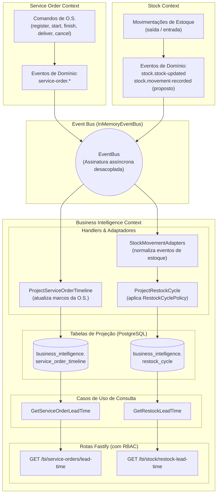
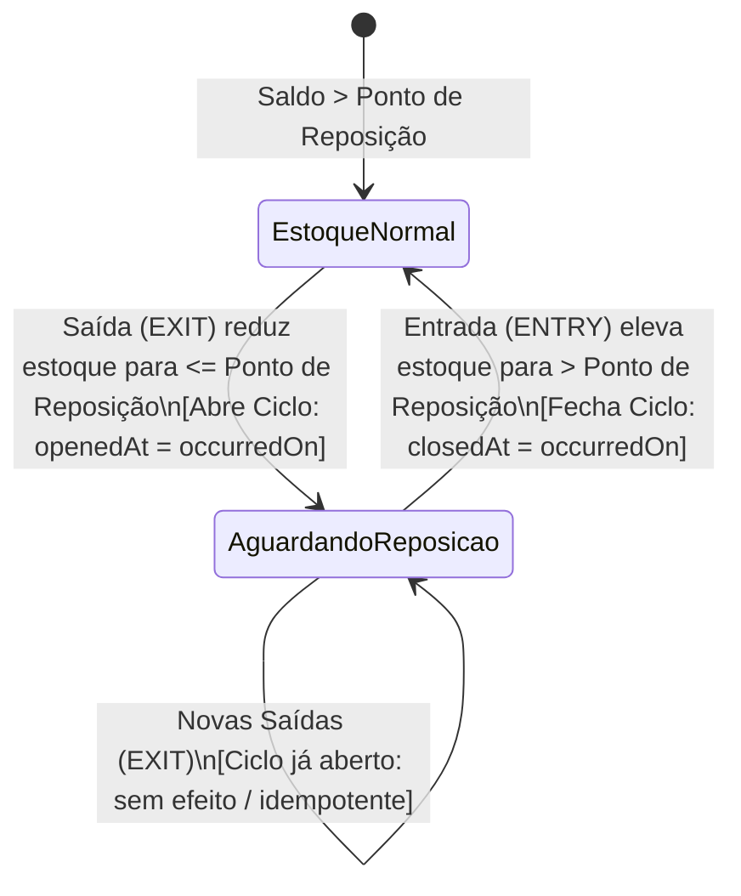

# Business Intelligence (BI) — Lead Time de O.S. e Tempo Médio de Reposição

O contexto delimitado **Business Intelligence** (`src/business-intelligence/`) consolida indicadores operacionais estratégicos da oficina mecânica (tempo de atendimento de ordens de serviço e tempo de reposição de peças em estoque) sem quebrar o isolamento de domínio nem acoplar esquemas de banco de dados com **Service Order**, **Stock** e **Auth**.

---

## 1. Visão Geral e Princípios Arquiteturais

Na arquitetura modular do projeto, cada contexto delimitado (_Bounded Context_) possui autonomia sobre seus dados e modelos de negócio. O módulo de Business Intelligence atua como um **Consumidor Orientado a Eventos** que constrói **Modelos de Leitura Dedicados (_Read Models / Projeções_)**, seguindo os princípios de CQRS (_Command Query Responsibility Segregation_):



### Princípios de Isolamento

1. **Integração exclusivamente via `EventBus`:** O BI não injeta repositórios, serviços de aplicação nem agregados dos outros contextos. Ele apenas assina eventos no barramento compartilhado (`InMemoryEventBus`).
2. **Contratos locais orientados ao consumidor (_Consumer-Driven Contracts_):** O BI define suas próprias interfaces em `src/business-intelligence/application/contracts/` para cada evento que consome, evitando qualquer importação transcontextual de TypeScript.
3. **Autonomia de persistência:** As tabelas `business_intelligence.service_order_timeline` e `business_intelligence.restock_cycle` pertencem exclusivamente ao schema `business_intelligence` (`infra/postgres/init/06-business-intelligence.sql`). **Não existem chaves estrangeiras (_foreign keys_) físicas** para `service_order.orders` ou `peca_insumo`, garantindo que uma futura extração do BI para um microsserviço ou Data Warehouse não demande quebras de integridade relacional.
4. **Idempotência por projeto:** Handlers de eventos gravam apenas os primeiros marcos ocorridos (`event.occurredOn`) e utilizam _upserts_ (`ON CONFLICT DO UPDATE`) para tolerar reentregas e eventos fora de ordem.
5. **Autorização desacoplada:** A verificação de segurança é feita via interface abstrata `BiAccessGuard` (`src/business-intelligence/application/ports/bi-access-guard.ts`), implementada pelo adaptador estrutural `TokenBiAccessGuard` (`src/infra/token-bi-access-guard.ts`), exigindo a permissão RBAC `BI_VISUALIZAR` (atribuída ao papel `GERENTE`).

---

## 2. Métricas Calculadas e Fórmulas

Todas as métricas utilizam o objeto de valor imutável `DurationStats` (`src/business-intelligence/domain/shared/duration-stats.ts`), que agrega durações em milissegundos e calcula média arredondada, mínimo, máximo e contagem:

```json
{
    "count": 12,
    "averageMs": 3600000,
    "minMs": 1800000,
    "maxMs": 7200000
}
```

> **Atenção:** Se não houver amostras no período filtrado, `count` será `0` e os campos `averageMs`, `minMs` e `maxMs` retornarão explicitamente `null`.

### 2.1. Lead Time de Ordens de Serviço (`GET /bi/service-orders/lead-time`)

A projeção `ServiceOrderTimeline` monitora o ciclo de vida de cada ordem de serviço a partir dos eventos de domínio e calcula três métricas distintas:

| Métrica                | Marco Inicial                                            | Marco Final                               | Descrição de Negócio                                                                                         |
| :--------------------- | :------------------------------------------------------- | :---------------------------------------- | :----------------------------------------------------------------------------------------------------------- |
| **`totalLeadTime`**    | `registeredAt` (`service-order.registered`)              | `finishedAt` (`service-order.finished`)   | Tempo total desde a criação da O.S. até a conclusão do serviço técnico pela oficina.                         |
| **`executionTime`**    | `executionStartedAt` (`service-order.execution-started`) | `finishedAt` (`service-order.finished`)   | Tempo efetivo em que o veículo permaneceu em execução mecânica (`IN_PROGRESS`).                              |
| **`deliveryLeadTime`** | `registeredAt` (`service-order.registered`)              | `deliveredAt` (`service-order.delivered`) | Tempo total ponta a ponta desde a abertura da O.S. até a entrega física do veículo ao cliente (`DELIVERED`). |

#### Regras de Negócio e Casos Especiais:

- **Ordens canceladas:** Se a O.S. receber o evento `service-order.cancelled` (`cancelledAt`), ela é **automaticamente excluída** de todas as médias e cálculos estatísticos.
- **Eventos fora de ordem ou inconsistentes:** Se uma diferença entre marcos resultar em valor negativo (relógios dessincronizados ou eventos desordenados), a métrica daquela O.S. específica é descartada (`null`), preservando a integridade da média geral.
- **Filtro temporal:** Os parâmetros `from` e `to` filtram as ordens de serviço com base no marco final da métrica (`finishedAt` para `totalLeadTime` e `executionTime`; `deliveredAt` para `deliveryLeadTime`).

---

### 2.2. Tempo Médio de Reposição de Estoque (`GET /bi/stock/restock-lead-time`)

Mede o intervalo de tempo em que uma peça/insumo permanece com estoque crítico ou esgotado até a chegada de uma nova remessa de reabastecimento.



#### Duração do Ciclo:

$$\text{Duração} = \text{closedAt} - \text{openedAt}$$

#### Estratégia Plugável (`RestockCyclePolicy`):

Como o módulo de histórico de alterações de estoque ainda está em desenvolvimento por outra equipe, a lógica de identificação de ciclos foi isolada em uma estratégia:

- **Implementação Padrão:** `ReorderPointRestockPolicy(reorderPoint)`.
- **Configuração:** O ponto de reposição padrão é `0` (reabastecimento após ruptura total de estoque), configurável dinamicamente via variável de ambiente `BI_REORDER_POINT`.
- **Ajustes manuais:** Entradas com motivo `MANUAL` (provenientes de inventário ou contagem física) não encerram ciclos de reposição de compras.

---

## 3. Contratos de Eventos e Integração entre Módulos

### 3.1. Eventos Consumidos de Service Order

| Evento                            | Publicador                      | Momento de Disparo                          | Impacto na Projeção do BI                                  |
| :-------------------------------- | :------------------------------ | :------------------------------------------ | :--------------------------------------------------------- |
| `service-order.registered`        | `RegisterServiceOrder`          | Cadastro inicial da O.S.                    | Registra `registeredAt` na timeline.                       |
| `service-order.execution-started` | `ServiceOrder.startExecution()` | Início do trabalho técnico (`IN_PROGRESS`)  | Registra `executionStartedAt` (apenas a 1ª ocorrência).    |
| `service-order.finished`          | `ServiceOrder.finish()`         | Conclusão dos reparos (`COMPLETED`)         | Registra `finishedAt` na timeline.                         |
| `service-order.delivered`         | `ServiceOrder.deliver()`        | Entrega do veículo ao cliente (`DELIVERED`) | Registra `deliveredAt` na timeline.                        |
| `service-order.cancelled`         | `CancelServiceOrder`            | Cancelamento da O.S. (`CANCELLED`)          | Registra `cancelledAt` (invalida a O.S. nas estatísticas). |

### 3.2. Eventos de Estoque e Contrato com a Equipe de Histórico

O BI já está preparado para consumir **dois formatos de evento** através do adaptador `StockMovementAdapters`:

#### A. Evento Atual (`stock.stock-updated`)

Emitido pelo agregado `PartSupply` nas operações de entrada (`registerEntry`) e saída (`deduct`):

```ts
interface StockUpdatedContract extends DomainEvent {
    readonly eventName: 'stock.stock-updated';
    readonly partCode: string;
    readonly movementType: 'ENTRY' | 'EXIT';
    readonly movedQuantity: number;
    readonly previousQuantity: number;
    readonly currentQuantity: number;
}
```

#### B. Contrato Proposto para o Histórico de Estoque (`stock.movement-recorded`)

Para a equipe responsável pela branch de histórico de estoque, propõe-se a publicação deste evento com enriquecimento de metadados:

```ts
interface StockMovementRecordedContract extends DomainEvent {
    readonly eventName: 'stock.movement-recorded';
    readonly aggregateId: string; // ID do PartSupply
    readonly movementId: string; // ID único do log/histórico (garante idempotência estrita)
    readonly partCode: string;
    readonly movementType: 'ENTRY' | 'EXIT' | 'ADJUSTMENT';
    readonly reason:
        'PURCHASE' | 'SERVICE_ORDER' | 'RESERVATION' | 'MANUAL' | 'RETURN';
    readonly quantity: number;
    readonly quantityBefore: number;
    readonly quantityAfter: number;
    readonly referenceId?: string; // Ex: ID da OS ou NF de compra
    readonly occurredOn: Date; // Timestamp real do fato
}
```

> **Aviso de Integração:** O arquivo `src/business-intelligence/composition-root.ts` já assina ambos os eventos. Quando o serviço de estoque for completamente integrado ao bootstrap principal em produção, basta garantir que apenas um evento por movimentação acione o handler de ciclo de reposição.

---

## 4. Especificação da API HTTP

Todas as rotas de BI são protegidas por autenticação JWT e exigem a permissão `BI_VISUALIZAR` (disponível exclusivamente para o perfil `GERENTE`).

### 4.1. Consulta de Lead Time de O.S.

**Endpoint:** `GET /bi/service-orders/lead-time`  
**Tags Swagger:** `Business intelligence`  
**Segurança:** `Bearer <JWT com permissão BI_VISUALIZAR>`

#### Parâmetros de Query (Opcionais):

| Parâmetro | Tipo              | Descrição                               |
| :-------- | :---------------- | :-------------------------------------- |
| `from`    | string (ISO-8601) | Data/hora inicial do período a filtrar. |
| `to`      | string (ISO-8601) | Data/hora final do período a filtrar.   |

#### Exemplo de Requisição:

```bash
curl -X GET "http://localhost:3000/bi/service-orders/lead-time?from=2026-05-01T00:00:00.000Z&to=2026-05-31T23:59:59.999Z" \
  -H "Authorization: Bearer <TOKEN_JWT_GERENTE>"
```

#### Exemplo de Resposta de Sucesso (`200 OK`):

```json
{
    "period": {
        "from": "2026-05-01T00:00:00.000Z",
        "to": "2026-05-31T23:59:59.999Z"
    },
    "totalLeadTime": {
        "count": 15,
        "averageMs": 86400000,
        "minMs": 43200000,
        "maxMs": 172800000
    },
    "executionTime": {
        "count": 15,
        "averageMs": 28800000,
        "minMs": 14400000,
        "maxMs": 72000000
    },
    "deliveryLeadTime": {
        "count": 12,
        "averageMs": 129600000,
        "minMs": 86400000,
        "maxMs": 259200000
    }
}
```

---

### 4.2. Consulta de Tempo de Reposição de Estoque

**Endpoint:** `GET /bi/stock/restock-lead-time`  
**Tags Swagger:** `Business intelligence`  
**Segurança:** `Bearer <JWT com permissão BI_VISUALIZAR>`

#### Parâmetros de Query (Opcionais):

| Parâmetro  | Tipo                | Descrição                                                |
| :--------- | :------------------ | :------------------------------------------------------- |
| `partCode` | string (3-50 chars) | Código da peça específico para filtragem.                |
| `from`     | string (ISO-8601)   | Data/hora inicial de encerramento do ciclo de reposição. |
| `to`       | string (ISO-8601)   | Data/hora final de encerramento do ciclo de reposição.   |

#### Exemplo de Requisição:

```bash
curl -X GET "http://localhost:3000/bi/stock/restock-lead-time?partCode=PAST-FREIO-01" \
  -H "Authorization: Bearer <TOKEN_JWT_GERENTE>"
```

#### Exemplo de Resposta de Sucesso (`200 OK`):

```json
{
    "period": {
        "from": null,
        "to": null
    },
    "policy": {
        "name": "REORDER_POINT",
        "reorderPoint": 0
    },
    "overall": {
        "count": 8,
        "averageMs": 259200000,
        "minMs": 86400000,
        "maxMs": 518400000
    },
    "byPart": [
        {
            "partCode": "PAST-FREIO-01",
            "count": 3,
            "averageMs": 172800000,
            "minMs": 86400000,
            "maxMs": 259200000,
            "openCycleSince": null
        },
        {
            "partCode": "OLEO-5W30",
            "count": 5,
            "averageMs": 311040000,
            "minMs": 172800000,
            "maxMs": 518400000,
            "openCycleSince": "2026-05-28T14:30:00.000Z"
        }
    ]
}
```

---

### 4.3. Códigos de Erro Padronizados

| Status Code        | Causa                                                                              | Exemplo de Resposta                                                                                                      |
| :----------------- | :--------------------------------------------------------------------------------- | :----------------------------------------------------------------------------------------------------------------------- |
| `400 Bad Request`  | Formato de data inválido, período invertido (`from > to`) ou `partCode` inválido.  | `{"error": "InvalidLeadTimePeriodError", "message": "Invalid period: \"from\" must be earlier than or equal to \"to\""}` |
| `401 Unauthorized` | Token ausente, token JWT inválido, expirado ou usuário inativo.                    | `{"error": "UnauthorizedError", "message": "Authentication required."}`                                                  |
| `403 Forbidden`    | Usuário autenticado, mas com papel sem permissão `BI_VISUALIZAR` (ex: `MECANICO`). | `{"error": "ForbiddenError", "message": "Insufficient permissions."}`                                                    |

---

## 5. Modelo de Dados no Banco de Dados (PostgreSQL)

O schema `business_intelligence` contém as duas tabelas de projeção gerenciadas via Drizzle ORM (`src/infra/database/schema.ts`) e inicializadas em `infra/postgres/init/06-business-intelligence.sql`:

```sql
CREATE SCHEMA IF NOT EXISTS business_intelligence;

-- 1. Projeção temporal de ordens de serviço
CREATE TABLE IF NOT EXISTS business_intelligence.service_order_timeline (
    service_order_id     VARCHAR(36) PRIMARY KEY,
    registered_at        TIMESTAMPTZ,
    execution_started_at TIMESTAMPTZ,
    finished_at          TIMESTAMPTZ,
    delivered_at         TIMESTAMPTZ,
    cancelled_at         TIMESTAMPTZ,
    updated_at           TIMESTAMPTZ NOT NULL DEFAULT CURRENT_TIMESTAMP
);

CREATE INDEX IF NOT EXISTS bi_sot_finished_at_idx
    ON business_intelligence.service_order_timeline(finished_at);

CREATE INDEX IF NOT EXISTS bi_sot_delivered_at_idx
    ON business_intelligence.service_order_timeline(delivered_at);

-- 2. Projeção de ciclos de reposição de peças
CREATE TABLE IF NOT EXISTS business_intelligence.restock_cycle (
    id                 VARCHAR(36) PRIMARY KEY,
    part_code          VARCHAR(50) NOT NULL,
    opened_at          TIMESTAMPTZ NOT NULL,
    closed_at          TIMESTAMPTZ,
    quantity_at_open   INTEGER NOT NULL,
    restocked_quantity INTEGER,
    CONSTRAINT bi_restock_cycle_dates_check CHECK (
        closed_at IS NULL OR closed_at >= opened_at
    )
);

-- Garante no máximo 1 ciclo aberto simultaneamente por peça
CREATE UNIQUE INDEX IF NOT EXISTS bi_restock_cycle_one_open_per_part
    ON business_intelligence.restock_cycle(part_code)
    WHERE closed_at IS NULL;

CREATE INDEX IF NOT EXISTS bi_restock_cycle_closed_at_idx
    ON business_intelligence.restock_cycle(part_code, closed_at);
```

---

## 6. Verificação e Testes

Para validar a integridade de todo o módulo e suas integrações:

```bash
# Validação estática de tipos
npm run typecheck

# Validação de estilo e boas práticas
npm run lint
npm run format:check

# Execução exclusiva dos testes do módulo BI e seu guard de autorização
npx vitest run src/business-intelligence src/infra/token-bi-access-guard.spec.ts

# Execução da suíte completa de testes do monólito
npm test
```
