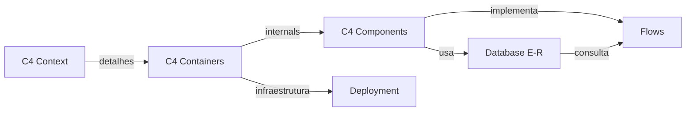

# 📑 Índice Visual dos Diagramas PlantUML

## 🗂️ Organização

```
docs/plantuml/
├── 🌐 C4 Context (Visão Geral)
│   └── c4-context.puml
│
├── 📦 C4 Containers (Componentes Principais)
│   └── c4-containers.puml
│
├── ⚙️ C4 Components (Arquitetura Interna)
│   └── c4-components.puml
│
├── 🗄️ Database (Modelo E-R)
│   └── database-er.puml
│
├── ☁️ Deployment (Infraestrutura)
│   └── deployment.puml
│
└── 📋 Flows (Sequências e Estados)
    ├── flows/client-registration.puml
    ├── flows/service-order.puml
    └── flows/states.puml
```

---

## 🎯 Fluxo de Leitura Recomendado

### Para Novos Devs (Onboarding)
1. **C4 Context** - Entender o sistema como um todo
2. **C4 Containers** - Conhecer os componentes principais
3. **C4 Components** - Mergulhar na arquitetura interna
4. **Database E-R** - Entender o modelo de dados
5. **Flows** - Estudar fluxos específicos de negócio

### Para Code Review
1. **C4 Components** - Contexto da mudança
2. **Flows** relacionados - Impacto na sequência
3. **Database E-R** - Mudanças em tabelas
4. **Deployment** - Impacto em escalabilidade

### Para Arquitetura/Design
1. **C4 Context** - Escopo e contexto
2. **C4 Containers** - Camadas e responsabilidades
3. **Deployment** - Considerações de infraestrutura
4. **Flows** - Padrões de integração

---

## 📊 Diagramas Detalhados

### 1. **C4 Context** (`c4-context.puml`)
```
┌─────────────────────────────────────────────────┐
│           SISTEMA API MECÂNICA                  │
├─────────────────────────────────────────────────┤
│  👤 Cliente                                     │
│  💼 Recepcionista                               │
│  🔧 Mecânico                      ─────────────>│ HTTP/REST
│  👨‍💼 Gerente                                     │
└─────────────────────────────────────────────────┘
           ↓ (conexões com externos)
    🗄️ PostgreSQL  📧 Email  💳 Payment  📱 SMS
```

**Use quando:** 
- Explicar o sistema para stakeholders
- Definir limites do sistema
- Identificar integrações externas

---

### 2. **C4 Containers** (`c4-containers.puml`)
```
┌──────────────── API MECÂNICA ──────────────────┐
│                                                │
│  🖥️ Web App  ──┐                              │
│  📱 Mobile ──┼─→ 🌐 API Server              │
│              │    ↓                          │
│              │  💾 Redis (cache)            │
│              │    ↓                          │
│              │  🗄️ PostgreSQL + 📁 S3      │
│                                                │
└──────────────────────────────────────────────┘
    ↓ (chamadas para)
📧 Email  💳 Payment  📱 SMS
```

**Use quando:**
- Planejar infraestrutura
- Discutir deployment
- Entender fluxo de dados entre serviços

---

### 3. **C4 Components** (`c4-components.puml`)
```
HTTP REQUEST
    ↓
┌─────────────────────────────────────┐
│ Express Server                      │
├─────────────────────────────────────┤
│ Controllers (REST endpoints)        │
├─────────────────────────────────────┤
│ Services (Business Logic)           │
├─────────────────────────────────────┤
│ Repositories (Data Access)          │
├─────────────────────────────────────┤
│ External Services & Database        │
└─────────────────────────────────────┘
    ↓
HTTP RESPONSE
```

**Use quando:**
- Entender fluxo interno de uma request
- Code review de novo módulo
- Implementar nova funcionalidade

---

### 4. **Database E-R** (`database-er.puml`)
```
clients (👥)
  ├─ vehicles (🚗) [one-to-many]
  ├─ service_orders (📋) [one-to-many]
  └─ payments (💳) [one-to-many]

service_orders (📋)
  ├─ service_items (📝) [one-to-many]
  ├─ payments (💳) [one-to-many]
  ├─ service_photos (📸) [one-to-many]
  └─ users (👤) [many-to-one]

payments (💳)
  └─ payment_receipts (📄) [one-to-many]

audit_logs (📊)
  └─ users (👤) [many-to-one]
```

**Use quando:**
- Modificar o banco de dados
- Entender relacionamentos
- Fazer queries complexas

---

### 5. **Deployment** (`deployment.puml`)
```
🌐 Internet
    ↓ HTTPS
┌──────────────────────────────────────┐
│ Load Balancer (AWS ALB)              │
├────┬─────────┬──────────┐            │
│    │         │          │            │
│  API-1    API-2      API-N            │
│    │         │          │            │
└────┴─────────┴──────────┘            │
│  💾 Redis Cache                      │
│  🗄️ PostgreSQL (RDS Multi-AZ)       │
│  📁 S3 Storage (+ CloudFront)        │
│  📋 Bull Job Queue                   │
└──────────────────────────────────────┘
       ↓ (integrações)
📧 SendGrid  💳 Stripe  📱 Twilio  📊 Datadog
```

**Use quando:**
- Planejar infraestrutura
- Discussões sobre escalabilidade
- Configurar monitoring

---

### 6. **Flows de Sequência**

#### `flows/client-registration.puml`
```
Recepcionista
    ↓ POST /clients
API
    ├→ Validar JWT
    ├→ Chamar ClientService
    │   ├→ Validar dados (CPF, email)
    │   ├→ Verificar duplicata (Cache + DB)
    │   ├→ Hash senha (bcrypt)
    │   ├→ Persistir no BD
    │   └→ Enviar email (async)
    └→ Resposta 201 Created
Recepcionista ✓
```

#### `flows/service-order.puml`
```
Recepcionista
    ↓ POST /service-orders
API
    ├→ Validar dados
    ├→ Verificar cliente existe
    ├→ Estimar preço
    ├→ Criar ordem no BD
    ├→ Invalidar cache
    ├→ Enviar email (async)
    └→ Resposta 201 Created
Recepcionista ✓
```

#### `flows/states.puml`
```
Máquinas de estado para:
- Cliente (CREATED → ACTIVE → SUSPENDED → DELETED)
- Ordem (PENDING → SCHEDULED → IN_PROGRESS → PAID → DELIVERED)
- Pagamento (PENDING → PROCESSING → AUTHORIZED → COMPLETED)
```

**Use quando:**
- Entender um fluxo específico
- Validar transições de estado
- Implementar webhooks

---

## 🔄 Interdependências



---

## 📝 Como Manter Atualizado

### Quando Adicionar um Novo Diagrama
1. Criar arquivo `.puml` na pasta apropriada
2. Adicionar referência aqui no `DIAGRAMS_INDEX.md`
3. Adicionar link no `README.md`
4. Commit com mensagem: `docs: adicionar diagrama de [X]`

### Quando Modificar um Diagrama
1. Editar o arquivo `.puml`
2. Verificar preview localmente
3. Commit com mensagem: `docs: atualizar diagrama de [X]`
4. Se for mudança significativa, atualizar este índice

### Checklist para PR
- [ ] Diagrama reflete o código/arquitetura atual
- [ ] Nomenclatura consistente com codebase
- [ ] Cores seguem paleta do projeto
- [ ] README.md está atualizado
- [ ] Este índice foi atualizado (se necessário)

---

## 🛠️ Ferramentas Recomendadas

### VSCode
- **Extensão**: PlantUML (`jjlive.plantuml`)
- **Atalho**: `Alt + D` para preview

### Linha de Comando
```bash
# Instalar
npm install -D @planttext/plantuml-cli

# Exportar PNG
npx plantuml -tpng docs/plantuml/c4-context.puml

# Exportar SVG (melhor para web)
npx plantuml -tsvg docs/plantuml/c4-context.puml

# Exportar todos
npx plantuml -tpng "docs/plantuml/**/*.puml"
```

### Online
- [PlantUML Online Editor](https://www.plantuml.com/plantuml/uml/)
- Coloque o conteúdo do arquivo `.puml` e veja o preview

---

## 📚 Referências

- [C4 Model by Simon Brown](https://c4model.com) - Modelo conceitual
- [PlantUML Documentation](https://plantuml.com/guide) - Sintaxe completa
- [PlantUML C4](https://plantuml.com/c4-diagram) - Específico para C4

---

**Mantido por:** Time de Desenvolvimento  
**Última atualização:** 2026-10-13  
**Status:** ✅ Completo e Atualizado
