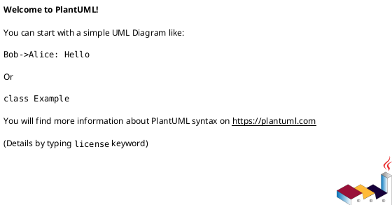

# 📊 Diagramas PlantUML - API Mecânica

Este diretório contém toda a documentação visual do sistema usando **PlantUML**, um formato de texto para diagramas que integra bem com Git e permite versionamento completo.

## 📂 Estrutura

```
plantuml/
├── README.md                          (este arquivo)
├── c4-context.puml                    (visão geral do sistema)
├── c4-containers.puml                 (componentes principais)
├── c4-components.puml                 (arquitetura interna)
└── flows/
    ├── client-registration.puml       (fluxo: registrar cliente)
    ├── service-order.puml             (fluxo: criar ordem de serviço)
    ├── payment-processing.puml        (fluxo: processar pagamento)
    └── states.puml                    (máquinas de estado)
```

## 🎯 Como Usar

### Visualizar localmente
1. Instale a extensão PlantUML no VSCode: `jjlive.plantuml`
2. Abra qualquer arquivo `.puml` e pressione `Alt + D` para preview

### Exportar para PNG/SVG
```bash
# Instalar PlantUML CLI
npm install -D @planttext/plantuml-cli

# Exportar um arquivo
npx plantuml -tpng docs/plantuml/c4-context.puml

# Exportar todos
npx plantuml -tpng "docs/plantuml/**/*.puml"
```

### No GitHub
PlantUML renderiza automaticamente em markdown:
````markdown

````

## 📋 Diagramas Disponíveis

### 1️⃣ C4 Context (`c4-context.puml`)
**Visão Geral do Sistema**
- Mostra o sistema no contexto completo
- Atores (Cliente, Recepcionista, Mecânico, Gerente)
- Sistemas externos (DB, Email, Payment, SMS)
- Protocolo: HTTP/REST

**Quando usar**: Explicar o sistema para stakeholders

---

### 2️⃣ C4 Containers (`c4-containers.puml`)
**Componentes Principais**
- Interfaces de cliente (Web App, Mobile App)
- Backend (API Node.js)
- Armazenamento (PostgreSQL, Redis, S3)
- Serviços externos (Email, SMS, Payment)

**Quando usar**: Arquitetura de deployment

---

### 3️⃣ C4 Components (`c4-components.puml`)
**Arquitetura Interna da API**
- Camadas: Transport, Controller, Service, Repository
- Fluxo de dados entre componentes
- Responsabilidades de cada camada

**Quando usar**: Code review, onboarding de devs

---

### 4️⃣ Fluxos de Sequência
Detalhes de como o sistema processa requisições:

#### `flows/client-registration.puml`
Registrar novo cliente (POST /clients)

#### `flows/service-order.puml`
Criar ordem de serviço (POST /service-orders)

#### `flows/payment-processing.puml`
Processar pagamento (POST /payments)

---

### 5️⃣ Máquinas de Estado (`flows/states.puml`)
Estados dos recursos principais:
- Estados de Cliente (Created → Active → Suspended → Deleted)
- Estados de Ordem (Pending → Scheduled → In Progress → Paid → Delivered)

---

## 🔗 Referências Cruzadas

Os diagramas fazem referência um ao outro:

```
C4 Context (visão geral)
    ↓ (detalha)
C4 Containers (componentes)
    ↓ (detalha)
C4 Components (internals)
    ↓ (detalha)
Flows (sequências específicas)
```

## 🛠️ Mantendo Atualizado

### Checklist para PRs
- [ ] Diagrama atualizado se mudança de arquitetura
- [ ] Commit message referencia o diagrama
- [ ] Nova funcionalidade tem fluxo em `flows/`

### Convenções
1. Use cores consistentes (veja paleta em config)
2. Nomeie componentes com padrão PascalCase
3. Mantenha setas e rótulos legíveis
4. Documente decisões de design no diagrama

## 📚 Recursos

- [PlantUML Docs](https://plantuml.com/guide)
- [C4 Model by Simon Brown](https://c4model.com)
- [PlantUML C4 Syntax](https://plantuml.com/c4-diagram)

## ✨ Exemplos Rápidos

### Estrutura básica
```plantuml
@startuml
!include https://raw.githubusercontent.com/plantuml-stdlib/C4-PlantUML/master/C4_Context.puml

' Seu diagrama
@enduml
```

### Componente customizado
```plantuml
component [Nome] as comp {
  [Sub A]
  [Sub B]
  [Sub A] --> [Sub B]
}
```

---

**Última atualização**: 2026-10-13  
**Mantido por**: Time de Desenvolvimento  
**Ferramenta**: PlantUML v1.2024+
